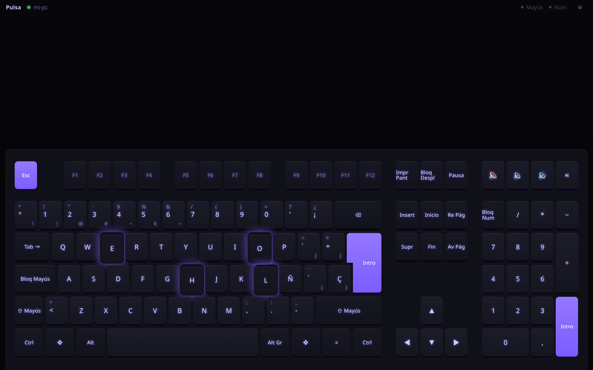

<p align="center">
  
</p>

<h1 align="center">Pulsa</h1>

<p align="center"><a href="README.md">Español</a> · <strong>English</strong></p>

<p align="center">
  <strong>Turn your Android tablet into a mechanical-sounding keyboard and trackpad.</strong><br />
  For your Linux PC (USB or WiFi), or for <em>any</em> device over Bluetooth with nothing installed on it.
</p>

<p align="center">
  <a href="https://github.com/sthifen/pulsa/releases/latest/download/pulsa.apk"></a>
  <a href="#install-on-the-pc"></a>
  <a href="https://github.com/sthifen/pulsa/releases/latest"></a>
</p>



- 🎹 **Full (100 %)** keyboard or **compact (60 %) + trackpad**, docked to the bottom edge so your hand rests on the desk, with palm rejection.
- 🔊 **13 synthesized sounds**, no audio files: blue, brown, red and cream switches, laptop, office, typewriter, plus six game-style ones (neon, laser, retro, bubble, wood and **crystal**, which turns your typing into a melody).
- 🔵 **Real Bluetooth keyboard and mouse** (Android 9+): pair it like any BT keyboard, no software on the other side. Great for a Raspberry Pi.
- 🔌 **USB bridge** for people with *no* input device at all: a ~$5 ESP32-S3 plugged into the computer acts as a real USB keyboard and mouse, no pairing on the host ([guide, in Spanish](firmware/README.md)).
- 🔒 New WiFi tablets must enter a 6-digit code shown on the PC.
- 📳 Haptics, keys that sink and glow, Caps/Num Lock LEDs mirrored from the host.
- 🌍 Sends physical key codes, so the host's layout applies (any language).
- 🪶 45 KB app; the PC side is one static binary (x86_64 and ARM64).

## Connect

| | Needs on the other device | 
|---|---|
| **Bluetooth** | Nothing: pair it as a keyboard (tested with Linux) |
| **USB cable** | Pulsa + `adb` (Linux) |
| **WiFi** | Pulsa (Linux) |

**Bluetooth:** install the [app](https://github.com/sthifen/pulsa/releases/latest/download/pulsa.apk) → *Usar como teclado Bluetooth* → ⚙ → *Hacer visible*, then pair the tablet from the other device (`bluetoothctl` → `scan on`, `pair`, `trust`, `connect` on a headless Pi).

### Install on the PC

**AppImage:** download [`Pulsa-x86_64.AppImage`](https://github.com/sthifen/pulsa/releases/latest/download/Pulsa-x86_64.AppImage) (or `Pulsa-aarch64.AppImage`), make it executable and double-click: a status page opens in your browser with the app QR code and pairing code.

**One line:**

```sh
curl -fsSL https://raw.githubusercontent.com/sthifen/pulsa/master/packaging/install.sh | sh
```

Puts one file in `~/.local/bin/pulsa`, starts it with your session (systemd user service) and grants `/dev/uinput`
access (asks for your password once; without it, GNOME still works through Mutter's remote desktop).
Or grab `pulsa-x86_64-linux` / `pulsa-aarch64-linux` from the [latest release](https://github.com/sthifen/pulsa/releases/latest),
or `cargo install --git https://github.com/sthifen/pulsa`.

The UI is in Spanish for now.

## License

[MIT](LICENSE). Made to help anyone left without a keyboard: use it, fork it, share it. Issues and PRs welcome.
