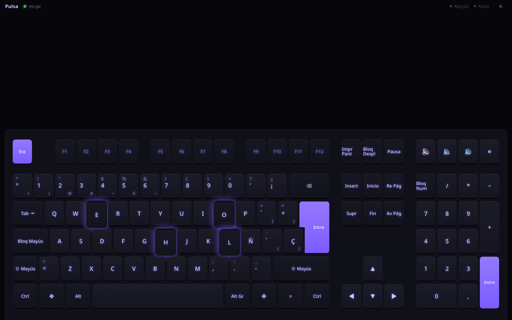
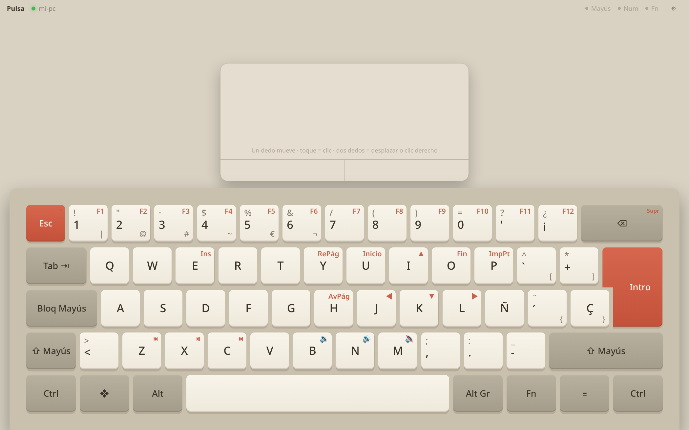
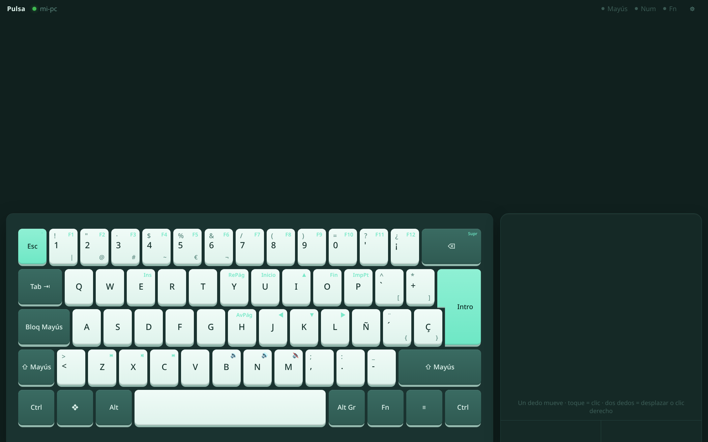
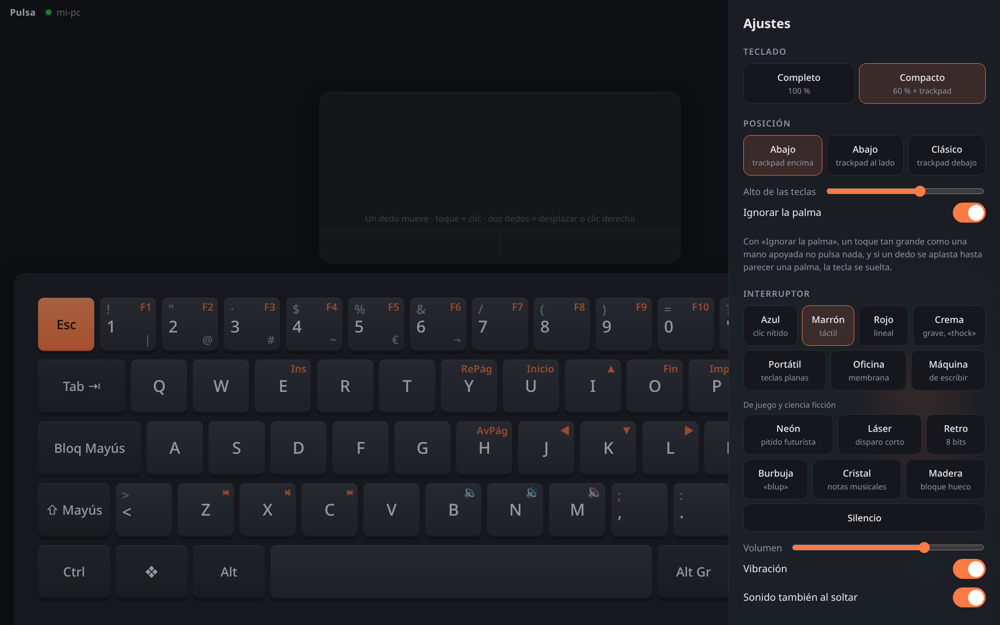

<p align="center">
  
</p>

<h1 align="center">Pulsa</h1>

<p align="center"><strong>Español</strong> · <a href="README.en.md">English</a></p>

<p align="center">
  <strong>Tu tablet Android convertida en un teclado mecánico, con sonido de interruptor, y trackpad.</strong><br />
  Para tu PC con Linux (por USB o WiFi) o para <em>cualquier</em> equipo por Bluetooth, sin instalar nada en él.
</p>

<p align="center">
  <a href="https://github.com/sthifen/pulsa/releases/latest/download/pulsa.apk"></a>
  <a href="#instalar-en-el-pc"></a>
  <a href="https://github.com/sthifen/pulsa/releases/latest"></a>
  <a href="https://github.com/sthifen/pulsa/releases"></a>
</p>



## Por qué

Una tablet sobre la mesa es una pantalla táctil enorme que casi siempre está apagada. Pulsa la convierte en el
teclado que te falta: para una Raspberry Pi sin teclado, para un PC del laboratorio, para el portátil cuando le
falla una tecla o simplemente porque escribir con «clac clac» se siente bien.

- 🎹 **Dos teclados**: completo (100 %, con numérico) o compacto (60 %) con trackpad.
- 🔊 **13 sonidos** generados al momento, sin archivos de audio: interruptores azul, marrón, rojo y crema, portátil,
  oficina, máquina de escribir y otros seis de juego (neón, láser, retro, burbuja, madera y **cristal**, que convierte
  lo que escribes en una melodía).
- ✋ **Hecho para apoyar la mano**: el teclado se pega al borde de abajo e ignora la palma apoyada.
- 📳 Vibración en cada pulsación, teclas que se hunden y brillan, y las luces de Bloq Mayús y Bloq Num del PC en la tablet.
- 🔵 **Bluetooth de verdad**: la tablet se anuncia como teclado y ratón Bluetooth. El otro equipo la empareja como
  cualquier teclado, sin programas ni drivers.
- 🇪🇸 Ñ, tildes y AltGr: se mandan teclas físicas, así que escribe con la distribución que tengas en el PC.
- 🪶 La app pesa **45 KB** y el programa del PC es un solo archivo sin dependencias.

| Compacto + trackpad, pegado abajo | Trackpad al lado |
|---|---|
|  |  |

## Tres formas de conectar

| | Qué necesita el otro equipo | Ideal para |
|---|---|---|
| **Bluetooth** | Nada. Lo empareja como un teclado más | Raspberry Pi, otro PC, móviles… (es un teclado Bluetooth estándar; probado con Linux) |
| **Cable USB** | Pulsa + `adb` | Tu PC con Linux, sin retraso |
| **WiFi** | Pulsa | Tu PC con Linux, sin cables |

### Bluetooth (sin instalar nada en el otro equipo)

1. Instala la [app](https://github.com/sthifen/pulsa/releases/latest/download/pulsa.apk) en la tablet (Android 9 o más reciente).
2. Toca **Usar como teclado Bluetooth** → ⚙ → **Hacer visible**.
3. En el otro equipo, busca dispositivos Bluetooth y empareja «Pulsa» o el nombre de tu tablet.
   En una Raspberry sin escritorio:
   ```sh
   bluetoothctl
   scan on            # espera a que salga la tablet
   pair  XX:XX:XX:XX:XX:XX
   trust XX:XX:XX:XX:XX:XX
   connect XX:XX:XX:XX:XX:XX
   ```
4. La próxima vez se conecta sola al abrir el modo Bluetooth.

### Instalar en el PC

Para el modo USB/WiFi, en Linux (x86_64 o ARM64):

```sh
curl -fsSL https://raw.githubusercontent.com/sthifen/pulsa/master/packaging/install.sh | sh
```

Descarga un único archivo a `~/.local/bin/pulsa`, lo deja arrancando solo con la sesión y da permiso al teclado
virtual (`/dev/uinput`, pide la contraseña una vez). Luego abre la app en la tablet: si está por cable se conecta
sola y, si está en la misma WiFi, aparece el nombre del PC para tocarlo.

<details>
<summary>Otras formas de instalarlo</summary>

- **A mano**: descarga `pulsa-x86_64-linux` o `pulsa-aarch64-linux` de la
  [última versión](https://github.com/sthifen/pulsa/releases/latest), dale permiso (`chmod +x`) y ejecútalo.
- **Con Cargo**: `cargo install --git https://github.com/sthifen/pulsa`
- **Desinstalar**: `curl -fsSL https://raw.githubusercontent.com/sthifen/pulsa/master/packaging/install.sh | sh -s -- --desinstalar`

Sin permiso en `/dev/uinput`, en GNOME funciona igual a través del escritorio remoto de Mutter (sin luces de
Bloq Mayús en la tablet). Para el cable USB hace falta `adb` (paquete `android-tools`) y la depuración USB activada
en la tablet; Pulsa configura `adb reverse` y abre la app solo.
</details>

## Ajustes



- **Fn** (compacto): los números dan F1–F12; I J K L son flechas; U/O, Inicio/Fin; Y/H, RePág/AvPág; Retroceso, Supr.
  Dos toques seguidos en Fn la dejan fija.
- **Trackpad**: un dedo mueve; un toque es clic; dos dedos desplazan (con inercia) o hacen clic derecho; tres, clic
  central; doble toque mantenido arrastra.
- **Ignorar la palma**: un contacto del tamaño de una mano no pulsa nada y suelta la tecla si la aplastas.
- Cuatro temas (Grafito, Crema, Menta y Noche), brillo arcoíris, alto de las teclas, letras impresas en español o inglés.

## Cómo funciona

```
Tablet (teclado web) ──WebSocket──► pulsa (PC) ──► /dev/uinput: teclado y ratón virtuales
          │                                    └─► o escritorio remoto de GNOME
          └──JavaScript → app Android ──► perfil Bluetooth HID ──► cualquier equipo
```

- `src/`: servidor en Rust (axum). Recibe códigos de tecla evdev y los mete como un teclado más; suelta todo si la
  tablet se desconecta, para que nunca se quede una tecla pegada.
- `web/index.html`: el teclado, los sonidos (síntesis con WebAudio) y el trackpad, en un solo archivo.
- `android/`: app en Java sin Gradle (`android/build-apk.sh`). `BtHid.java` traduce los mismos mensajes a informes
  HID de Bluetooth.

Compilar todo: `packaging/build-dist.sh` (binarios estáticos x86_64 y ARM64 + APK en `dist/`).
